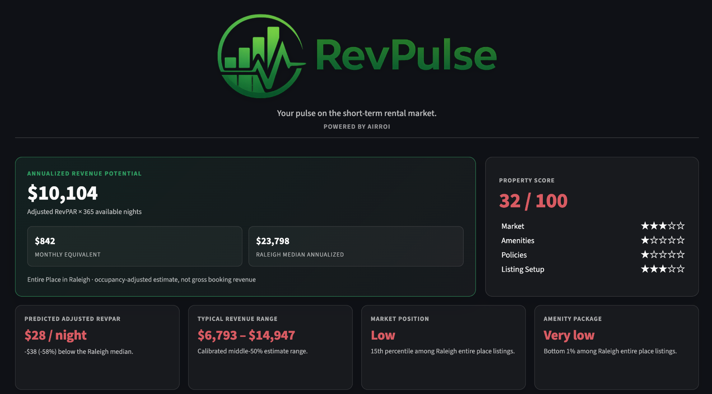
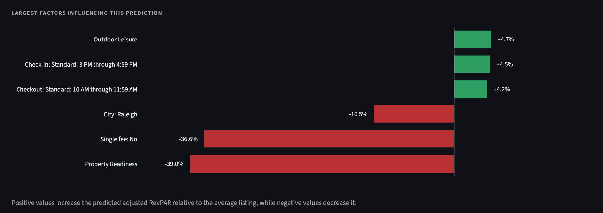
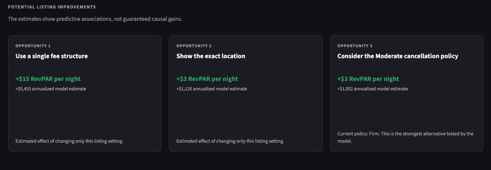

# RevPulse — Short-Term Rental Market Intelligence

RevPulse is a **Streamlit analytics application** designed to help explore short-term rental revenue opportunities. It combines an **Elastic Net predictive model** with comparable-property data, market and property reference information, and an interactive interface.

## What the application demonstrates

- Translating a modeling workflow into a user-facing decision-support application
- Using a serialized modeling bundle for inference (including preprocessing metadata)
- Combining modeled estimates with property comparables and market context
- Presenting results with interactive tables, charts, and map-based views
- Incorporating calibration/reference datasets into the interface

## Application Preview

### Revenue Prediction Dashboard

RevPulse estimates annualized rental revenue potential and presents a property score, a typical revenue range, and comparisons with the local market.



### Prediction Drivers

The application highlights the features associated with higher or lower predicted adjusted revenue per available night (RevPAR), providing context for its estimates.



### Potential Listing Improvements

RevPulse presents model-based estimates for changes to listing settings, making the prediction easier to translate into practical decisions. These are **predictive associations, not guaranteed causal gains**.




## Technology

Python, Pandas, NumPy, Scikit-learn, Streamlit, Plotly, Folium, and Streamlit-Folium.

## Run locally

From the **repository root**:

```bash
pip install -r requirements.txt
streamlit run app_final_updated.py
```

The application depends on the model bundle and reference CSV files committed alongside `app_final_updated.py`. Keep these in the expected relative locations when running the application.

## Repository contents

- `app_final_updated.py` — Streamlit application and prediction interface
- `elastic_net_streamlit_bundle.pkl` — serialized fitted model and associated preprocessing metadata
- `airroi_comparables.csv` — comparable-property reference data
- `revpulse_interval_calibration.csv` — interval-calibration reference data
- `revpulse_property_score_reference.csv` — property-score reference values
- `revpulse_market_score_reference.csv` — market-score reference values
- `revpulse_feature_category_map.csv` — feature categorization reference
- `RevPulse_Updated_Deployment/` — alternate deployment package retained in the current repository

## Scope and limitations

This is an **analytical prototype**, not a guarantee of property revenue. Estimates depend on the training data, modeled relationships, and the relevance of comparisons to a given property. Model accuracy, calibration coverage, and performance on new markets should be evaluated separately before relying on predictions for investment decisions.

The repository contains the inference application and trained model bundle. It does **not** by itself establish a fully reproducible model-training pipeline or documented out-of-sample performance.

## Portfolio context

The project's focus is taking statistical modeling beyond a notebook and putting it into an interface that can support an actual business question.
